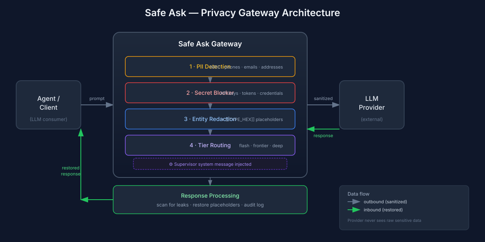

# Safe Ask

**Privacy-preserving LLM gateway for AI agents.**

Send prompts to external inference models without leaking PII, credentials, or internal context.

---

## The Problem

AI agents routinely need external model calls — second opinions, stronger reasoning, classification, summarization. But every direct call to an LLM provider risks:

- **PII exposure** — names, NRIC/FIN, phone numbers, addresses in prompt text
- **Credential leakage** — API keys, tokens, or secrets accidentally included
- **Internal context disclosure** — hostnames, client names, infrastructure details

You can't rely on the agent to "remember" to strip sensitive data. It needs an enforcement layer.

---

## The Solution

Safe Ask is a lightweight privacy gateway that sits between your agent and any LLM provider. Every request passes through three stages before it ever reaches an external model:

```
┌──────────┐      ┌─────────────────────┐      ┌──────────────┐
│  Agent   │ ───▶ │   Safe Ask Gateway  │ ───▶ │ LLM Provider │
│ (client) │ ◀─── │  redact → route →   │ ◀─── │              │
└──────────┘      │     restore         │      └──────────────┘
                  └─────────────────────┘
```

1. **Redact** — Detect and replace sensitive entities (PII, secrets, known protected values) with opaque placeholders before the request leaves your infrastructure.
2. **Route** — Forward the sanitized request to the appropriate model tier (fast/cheap for routine tasks, frontier or deep for hard reasoning).
3. **Restore** — Map placeholders back to real values in the model's response, so your agent sees coherent output without the provider ever seeing the raw data.

---

## Architecture



### Request flow

| Stage | Component | What happens |
|-------|-----------|--------------|
| 1 | **Ingest** | Client sends prompt to gateway (OpenAI-compatible endpoint) |
| 2 | **PII Detection** | Scans for NRIC/FIN, phone numbers, emails, addresses, postal codes |
| 3 | **Secret Blocker** | Rejects requests containing detected credentials or keys |
| 4 | **Entity Redaction** | Replaces known protected entities (from local registry) with `[[TYPE_HEX]]` placeholders |
| 5 | **Supervisor Injection** | Adds mandatory system message instructing the model to treat placeholders as sensitive |
| 6 | **Tier Routing** | Dispatches to upstream provider via configured tier aliases |
| 7 | **Response Scan** | Flags newly exposed sensitive values in the response |
| 8 | **Placeholder Restore** | Maps placeholders back to original values before returning to client |

### Key properties

- **OpenAI-compatible API** — drop-in replacement; clients only change the base URL
- **Local-first** — all redaction logic runs on your infrastructure; no third-party preprocessing
- **Tier abstraction** — semantic tiers (`flash`, `frontier`, `deep`) decouple clients from specific model providers
- **Audit trail** — every redaction event is logged for compliance review

---

## What gets redacted

| Category | Examples |
|----------|----------|
| National IDs | NRIC/FIN (Singapore), SSN, Aadhaar |
| Contact info | Phone numbers, email addresses |
| Physical addresses | Street addresses, unit numbers, postal codes |
| Credentials | API keys, tokens, passwords (pattern-based + known-value registry) |
| Protected entities | Custom list — client names, internal hostnames, project codenames |

Redaction is **not anonymization**. Placeholders preserve structure and type so the model can reason correctly, but never see the actual values.

---

## Quick start

### Server

```bash
pip install safe-ask

# Configure providers and tiers in config.yaml, then:
safe-ask serve --port 8787
```

### Client

```bash
export SAFEASK_URL=http://localhost:8787

# Simple call
curl -s $SAFEASK_URL/v1/chat/completions \
  -H 'Content-Type: application/json' \
  -d '{"model": "flash", "messages": [{"role": "user", "content": "Summarize this"}]}'

# Python client
from safe_ask import Client
client = Client(base_url="http://localhost:8787")
response = client.ask("Analyze this pattern", tier="frontier")
```

---

## Use cases

- **Multi-agent systems** — agents calling other agents or external models for second opinions
- **Research pipelines** — batch processing documents that contain sensitive data
- **Customer-facing apps** — user content sent to LLMs without exposing PII to providers
- **Compliance environments** — GDPR/HIPAA/PIPDPA workflows requiring data residency controls

---

## Design principles

1. **Enforcement, not discipline** — don't rely on agents to strip sensitive data; make it structural
2. **Minimize before sending** — redaction is a safety net, not permission to include unnecessary context
3. **Placeholders, not omissions** — preserve type and structure so models reason correctly on redacted inputs
4. **Local control** — detection and restoration logic never leave your infrastructure

---

## License

MIT

---

Built for teams running AI agents on sensitive data.
